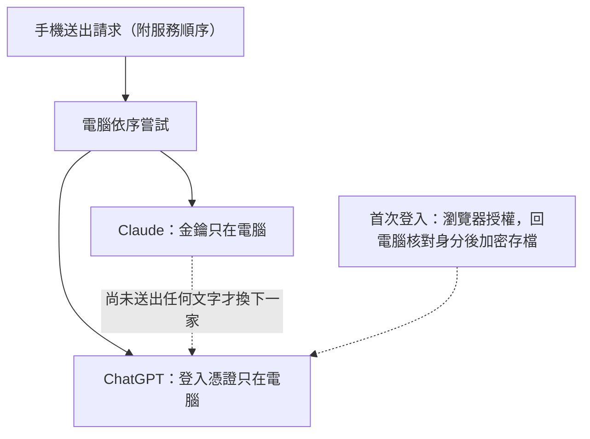

# 0009 AI 路由與登入：Claude 與 ChatGPT 依序備援

- 狀態：已採用

## 背景
聊天與背景工作原本只能用 Anthropic API 金鑰。要能改由已登入的 ChatGPT 帳號回答，又不能讓金鑰或 token 進到手機，也不能因為一家服務掛掉整個功能停擺。兩家的請求格式不同：Anthropic Messages 與 OpenAI Responses。

## 考慮過的選項
**A. 每個功能各自分支**（聊天、判斷、小提醒、速查各自判斷用哪一家）
- 優點：沒有抽象層，直接好懂。
- 缺點：四個功能各寫一次分支與錯誤判斷，很容易彼此不一致。

**B. 統一的供應商介面，請求以 Anthropic 格式為準，由各家轉接（採用）**
- 優點：路由、防護、串流與計費只寫一次；加一家服務只加一個轉接器。
- 缺點：OpenAI 端要做格式轉換；Anthropic 專屬的快取點對 OpenAI 無效。

**C. 外接代理（例如 LiteLLM）**
- 優點：不必自己寫轉換。
- 缺點：多一個常駐程序與依賴；OAuth 登入與方案額度仍要自己處理。

## 決定
每個 AI 請求都帶一份服務順序（1 到 2 家、不重複，預設只有 Claude）與可選的 ChatGPT 模型，伺服器依序嘗試。ChatGPT 以 OpenAI 官方 OAuth（PKCE）登入；金鑰與 token 只存在這台電腦。登入與登出只能在電腦上按，手機只看登入狀態，並可以選 ChatGPT 的模型。

## 做法

- 手機不碰金鑰或 token；格式轉換由電腦完成，只送對方認得的內容。
- 登入憑證加密存在這台電腦，加密金鑰交給 Windows 的使用者保護機制保管。

## 取捨
- 格式轉換是有損的：OpenAI 端只收文字，快取點與 Anthropic 專屬的測試功能不轉送。
- ChatGPT 的用量不計入每日上限（MUGI_DAILY_USD），那個上限只管 Claude。
- 串流一旦送出文字就不能換服務，避免兩家的文字接在一起。
- 手機不能登入或登出 ChatGPT：換帳號或重新授權，要走到電腦前操作。代價是遠端不能獨自完成登入。
- 憑證檔無法解開時伺服器停止、不覆寫，避免把登入資料弄丟。非 Windows 沒有這層保護，憑證檔以僅本人可讀寫的權限存成純 JSON。

## 何時重新評估
- 加入第三家服務 → 擴充服務清單與數量上限，新增一個轉接器。
- OpenAI 改版回應格式或登入端點 → 重新測試格式轉換與登入時的設定探索檢查。
- Anthropic 的自動換模型測試功能行為改變 → 重看聊天請求的測試功能設定與換模型設定。

## R2 T1：ChatGPT 相容性與錯誤處理（2026-11-11）

施工基底為 `feat/mugi-private-pwa-animation` 的 `2714f7dcfa7f5fff00c243116ef5da315278b961`。本次僅修正 ChatGPT 相容性及錯誤處理，不變更預設供應商、不新增或自動啟用付費備援。

### 官方規格查核

本次重新查閱以下 OpenAI 官方文件；這些是預覽規格，未代表真實帳號已驗收：

- [Models and inference](https://developers.openai.com/siwc/token-sharing-open-source/models-and-inference)：以同一帳號的 OAuth token 讀取 `/v1/models`，顯示 `visibility: list` 的項目、保留官方順序，以 `slug` 呼叫公開 `/v1/responses`。只有收到 `response.completed` 才算成功。
- [Preview limitations](https://developers.openai.com/siwc/token-sharing-open-source/preview-limitations)：HTTP 必須使用 `store: false`、`stream: true`、陣列 `input`；`max_output_tokens` 仍不受支援。系統提示使用 `instructions`。
- [Errors and recovery](https://developers.openai.com/siwc/token-sharing-open-source/errors-and-recovery)：方案額度限制與暫時無法查核用量是不同錯誤；暫時故障保留憑證，不推算恢復時間。

### 實作契約

- 模型不設 GPT 世代上限，也不硬編碼新增模型。僅從帳號可見目錄選取，顯示 `display_name`（缺少時用 slug），不再把 Sol 排到最前面。未曾選擇模型時才使用官方清單第一個相容項目。
- 本機相容性規則：slug 必須符合既有路由長度上限與英數、點、底線、連字號格式；排除名稱中明確標示 image、audio、realtime、transcribe、tts、whisper、embedding、moderation、dall-e、sora 的專用模型。這是本 App 文字 Responses 路徑的篩選，不是 OpenAI 提供的完整能力保證；未識別的未來模型可顯示，實際能力拒絕仍回報上游錯誤，不偷偷換模型。
- 已選模型不在相容目錄時，設定頁保留原值並提示重新選擇；伺服器不改用第一個 ChatGPT 模型。僅可繼續使用請求中原已明確啟用的其他供應商。
- `/api/openai/status` 保留 `signedIn`、`planEnabled`，授權後另以 `modelStatus` 回報 `ready`、`empty`（沒有可見模型）、`incompatible`（有可見模型但均不符本機規則）、`error`（HTTP、網路、JSON 或目錄格式失敗）。未登入、未授權與 Acceptance 的固定假狀態不需要該欄位，前端也相容舊狀態格式。例外本文與原始上游錯誤不放進狀態端點；email 仍限本機。
- OAuth 請求不送 `max_output_tokens` 或其他 Anthropic 專用欄位。Anthropic adapter 與其 `max_tokens` 保持原樣。測試攔截實際 transport/fetch 的 JSON 欄位，而非僅比對 helper 快照。
- 本機回覆上限為 32,000 UTF-16 字元，SSE 待處理緩衝上限為 1,048,576 字元；超限取消 reader 並報錯，不將截斷內容當成功。此限制不是 token 計數，也不保證遠端額度用量。聊天與未指定逾時的單次請求最多 120 秒，單次請求可使用原有較短逾時。取消與清理由持有鎖的 reader 執行。
- `subscription_sharing_usage_limit_exceeded` 提示暫停請求並查看 [ChatGPT 用量](https://chatgpt.com/settings/usage)，不宣稱整份方案耗盡或猜重置時間；`subscription_sharing_usage_unavailable` 提示暫時無法查核、稍後再試，保留登入資料。403 權限／政策限制不再一律當成登出。
- `aiChain` 既有通用規則已匹配這兩個代碼，保留該規則，只增加 `partialOutput` 阻擋條件：包含單次請求緩衝的部分文字，收到後失敗不再送另一家。聊天的既有文字輸出界線與取消不備援規則仍保留。
- HTTP 錯誤、`response.failed`、`response.incomplete`、缺少完整終止事件及截斷串流都不能視為成功；不加入自動重試或計費路徑切換。

### 驗證與待實機驗收

測試使用記憶體憑證、假 OAuth、假 fetch 與供應商替身；涵蓋僅 6.x 可見目錄、狀態區分與去敏、選擇保留、實際請求欄位、兩種方案錯誤、取消、逾時、長度保護及部分輸出後禁止備援。本機驗證結果：95 個測試檔通過、1,476 項測試通過、1 項既有真實 VOICEVOX opt-in 測試跳過；完整建置通過；既有 production smoke 3 項通過（含 Acceptance 隔離）。`openaiComplete` 的登入 callback 測試補上假模型目錄 fetch，避免測試登入後意外發出網路請求。

仍需使用者另行於授權的實機環境驗收：真實帳號的可見模型／方案授權、OAuth Responses 實際相容性、真實限制或服務中斷時的訊息、電腦及手機設定頁顯示。這次未執行真實 OAuth 登入或 AI／STT／TTS 呼叫，也未測試真實付費備援。未部署、未合併、未修改 Windows 腳本或 Tailscale，Acceptance 限制保持不變。
